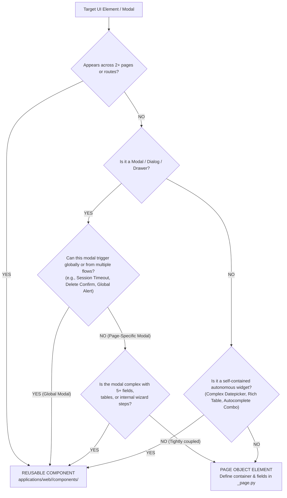

# Skill: Analyze UI Components & Modal Decomposition

This skill provides the mandatory decision framework, inspection heuristics, and implementation blueprint to decide **when an interface block or modal must become a reusable `BaseComponent`** versus remaining inside a `BasePage`.

---

## 0. The 4-Pillar Component Decision Matrix

When analyzing a live DOM (via the **Selenium MCP**) or reviewing wireframes/requirements, evaluate the target element against these 4 pillars:



---

## 1. Modals & Dialogs Deep Dive: Global vs. Page-Specific

A common architectural trap is treating all modals the same. Follow this strict classification:

### A. Global Modals (`components/<modal_name>_component.py`)
A modal is **GLOBAL** when:
1. **Triggered from anywhere**: It can pop up regardless of which URL the user is on (e.g., Session Expiration Warning, Global Confirm Dialog, Terms of Service re-acceptance, Error / Server Disconnect alert).
2. **Generic Reusable Template**: It is a standardized design system dialog (e.g., `ConfirmationModalComponent` with `title`, `body_text`, `btn_confirm`, `btn_cancel`) reused across multiple distinct business pages.
3. **Mounted at DOM Root**: Inspecting with the Selenium MCP reveals it is rendered as a direct child of `<body>` or `<div id="portal-root">` / `<div id="modal-container">`, independent of the page's main `<main>` or `<article>` layout.

**Action**: Implement as a `BaseComponent` in `applications/web/<app>/components/<modal_name>_component.py`.

### B. Page-Specific Modals
A modal is **PAGE-SPECIFIC** when:
1. **Tightly coupled to a single page's transaction**: It only exists within one specific flow (e.g., *Add Shipping Address Modal* inside `CheckoutPage`, or *Quick View Item Modal* inside `InventoryPage`).
2. **Sub-rule for Page-Specific Modals**:
   - **If simple (< 4 fields)**: Model it directly inside the Page Object using `ContainerElement` with semantic prefixes (`mdl_address`, `btn_save_address`, etc.).
   - **If complex (Wizard, Table, 5+ inputs)**: Even if exclusive to that page, extract it into `components/<feature>_<modal>_component.py` to keep the Page Object clean and focused.

---

## 2. Catalog of Standard Components vs Page Elements

| UI Pattern / Element | Classification | Target Location | Rationale |
| :--- | :---: | :--- | :--- |
| **Top Navigation Bar / Header** | **Component** | `components/header_component.py` | Present across all authenticated views. |
| **Sidebar / Burger Menu** | **Component** | `components/sidebar_component.py` | Present across inventory, cart, detail, etc. |
| **Footer / Legal Links** | **Component** | `components/footer_component.py` | Reused across all or most pages. |
| **Session Timeout Modal** | **Global Modal** | `components/session_timeout_modal_component.py` | Can trigger asynchronously on any page. |
| **Confirm Action Dialog** | **Global Modal** | `components/confirm_dialog_component.py` | Reused for delete, discard, approve. |
| **Toast / SnackBar Notification** | **Component** | `components/notification_toast_component.py` | Appears floating over any screen. |
| **Complex Table / Grid** | **Component** | `components/data_grid_component.py` | Rich behavior (sorting, paging, filters). |
| **Item Detail Quick-View Modal** | **Page Modal** | `components/item_detail_modal_component.py` | Complex sub-view of InventoryPage. |
| **Login Form** | **Page** | `pages/login_page.py` | Screen-specific transaction. |
| **Checkout Step 1 Form** | **Page** | `pages/checkout_page.py` | Screen-specific transaction. |

---

## 3. DOM Inspection Steps with Selenium MCP

When inspecting a live application to identify components:

1. **Step 1: Check Multi-Page Presence**:
   - Navigate to Screen A (`navigate(url_a)`) and note navigation bars, footers, sidebars.
   - Navigate to Screen B (`navigate(url_b)`) and execute script to check if the same selector exists:
     ```javascript
     return document.querySelector('#header, [data-test="nav-menu"], .sidebar') !== null;
     ```
2. **Step 2: Inspect Modal Portals**:
   - Trigger a modal and check where in the DOM it was attached:
     ```javascript
     const activeModal = document.querySelector('.modal, [role="dialog"], .fade.show');
     return {
       tag: activeModal.tagName,
       parentTag: activeModal.parentElement.tagName,
       isBodyDirectChild: activeModal.parentElement === document.body,
       id: activeModal.id,
       role: activeModal.getAttribute('role')
     };
     ```
   - If attached directly to `<body>` or a portal container, evaluate if its trigger source is global or local.

---

## 4. Implementation Blueprint

### A. Creating the Reusable Component (`components/<name>_component.py`)
Must inherit from `BaseComponent` and follow the 3-Layer standard:

```python
from typing import Self
from core.ui.common.base_component import BaseComponent
from core.ui.common.find_by import find_by
import allure


class ConfirmDialogComponent(BaseComponent):
    """
    Reusable confirmation dialog component (Global Modal).
    Handles 'Are you sure?' prompts for destructive or critical actions.
    """

    # --- Layer 1: Locators ---
    mdl_container = find_by(css="[role='dialog'].confirm-dialog", label="Confirm Dialog Container")
    lbl_title = find_by(css="[role='dialog'] .dialog-title", label="Dialog Title")
    lbl_message = find_by(css="[role='dialog'] .dialog-message", label="Dialog Message")
    btn_confirm = find_by(css="[role='dialog'] button.btn-confirm", label="Confirm Button")
    btn_cancel = find_by(css="[role='dialog'] button.btn-cancel", label="Cancel Button")

    # --- Layer 2: Atomic Methods ---
    def get_title(self) -> str:
        return self.lbl_title.wait_visible().get_trimmed_text()

    def get_message(self) -> str:
        return self.lbl_message.get_trimmed_text()

    def is_dialog_visible(self) -> bool:
        return self.mdl_container.is_visible()

    @allure.step("Confirming dialog action")
    def click_confirm(self) -> Self:
        self.btn_confirm.click()
        self.mdl_container.wait_disappear()
        return self

    @allure.step("Cancelling dialog action")
    def click_cancel(self) -> Self:
        self.btn_cancel.click()
        self.mdl_container.wait_disappear()
        return self

    # --- Layer 3: Composite Method ---
    def confirm_if_visible(self) -> Self:
        if self.is_dialog_visible():
            self.click_confirm()
        return self
```

### B. Integrating into Page Objects via `component(...)`
In any `BasePage` that displays or can display this component, bind it declaratively:

```python
from core.ui.common.base_page import BasePage
from core.ui.common.base_component import component
from applications.web.demo.components.sidebar_component import SidebarComponent
from applications.web.demo.components.confirm_dialog_component import ConfirmDialogComponent


class InventoryPage(BasePage):
    PAGE_PATH = "/inventory.html"

    # Bind reusable components declaratively
    sidebar = component(SidebarComponent)
    confirm_dialog = component(ConfirmDialogComponent)

    # Page-specific locators & methods...
```

### C. Consuming in Test Cases
Tests access components seamlessly via `self.app.<page>.<component>.<action>()`:

```python
def test_delete_item_with_confirmation(self):
    inventory = self.app.inventory_page.open()
    inventory.click_delete_product("Backpack")
    
    # Global modal verified and handled via the bound component:
    assert inventory.confirm_dialog.is_dialog_visible()
    assert "Are you sure" in inventory.confirm_dialog.get_message()
    inventory.confirm_dialog.click_confirm()
```

