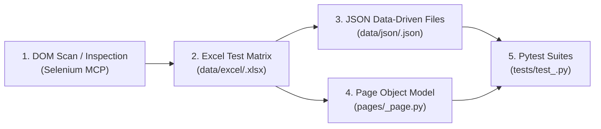

# Skill: Design Test Cases in Excel (`design-test-cases-excel`)

This skill defines the methodology for analyzing a page/feature, structuring granular test cases by functional feature, and compiling them into a professional Microsoft Excel (`.xlsx`) workbook placed inside `applications/<mode>/<app>/data/excel/`.

---

## 0. Purpose & Architecture Flow

Excel serves as the **Design & Functional Specification Bridge**:



1. **Scan first**: Explore the live DOM with the Selenium MCP to discover all elements, interactive states, validation classes, error banners, and edge cases.
2. **Decompose features**: Never create one giant monolithic test list. Break the page down into focused feature domains (e.g. for Login: `AUTH-POSITIVE`, `AUTH-NEGATIVE`, `AUTH-VALIDATION-UX`, `AUTH-SECURITY-MASKING`, `AUTH-ERROR-RECOVERY`, `AUTH-FOOTER-CREDENTIALS`).
3. **Keep tests atomic**: Each test case must validate a single behavior, error, or state.
4. **1:1 Alignment with JSON 360° Schema**: Column fields in Excel map directly to the JSON metadata, `tests.data`, and `tests.expected`.

---

## 1. Mandatory Excel Columns & Schema

Every generated Excel test sheet **MUST** include the following columns with professional formatting (dark navy header, white bold text, auto-adjusted column widths, text wrapping, and alternating zebra rows):

| Column Index | Column Header | Description & JSON Mapping | Example Value |
| :---: | :--- | :--- | :--- |
| **A** | **Test ID** | Unique identifier matching `@test_case(id="...")` and `<ID>.json`. | `CT-LOGIN-001` |
| **B** | **Epic** | High-level business domain (`tests.epic`). | `Identity & Access Management` |
| **C** | **Feature** | Target functional area (`tests.feature`). | `Form Validation UX` |
| **D** | **Story** | User story or requirement (`tests.story`). | `Required Field Highlights` |
| **E** | **Test Case Title** | Clear, concise scenario name (`tests.title`). | `Login attempt with empty username displays required alert` |
| **F** | **Type** | Test category tag (`tests.tag`). | `NEGATIVE` / `POSITIVE` / `SECURITY` / `UI-UX` |
| **G** | **Priority** | Execution importance (`tests.priority`). | `P1` / `P2` / `P3` |
| **H** | **Severity** | Business impact severity (`tests.severity`). | `Critical` / `High` / `Medium` / `Low` |
| **I** | **Preconditions** | Prerequisites (`tests.preconditions`). | `Login page loaded; Fields empty` |
| **J** | **Execution Steps** | Numbered sequence of user actions. | `1. Open login page\n2. Leave username empty\n3. Click Login` |
| **K** | **Test Data (Input JSON)** | Dictionary mapped to `tests.data` (for `fill_form`). | `{"username": "", "password": "secret_sauce"}` |
| **L** | **Expected Results (Oracle JSON)** | Dictionary mapped to `tests.expected` (for `assert`). | `{"error_key": "messages.error_username_required"}` |
| **M** | **Automation Status** | Lifecycle tracking. | `READY_FOR_AUTOMATION` / `AUTOMATED` / `MANUAL` |

---

## 2. Feature Breakdown Guidelines for Login Pages

When designing test cases for an authentication or login view, divide the scenarios into these specific feature groups:

1. **Feature: Happy Path & Session Lifecycle**
   - Standard user login with valid credentials $\rightarrow$ Redirects to inventory.
   - Logout from inventory via sidebar $\rightarrow$ Returns to login page with clean state.
   - Dynamic credential extraction $\rightarrow$ Login using credentials read directly from the page footer.

2. **Feature: Credential Roles & Account Statuses**
   - Locked out user (`locked_out_user`) $\rightarrow$ Validates locked account error message.
   - Problem user (`problem_user`) $\rightarrow$ Validates behavior under degraded account assets.
   - Performance glitch user (`performance_glitch_user`) $\rightarrow$ Validates SLA and latency handling.
   - Visual user (`visual_user`) $\rightarrow$ Validates visual layout consistency.

3. **Feature: Negative Scenarios & Missing Fields**
   - Empty username with valid password $\rightarrow$ Validates `Username is required`.
   - Valid username with empty password $\rightarrow$ Validates `Password is required`.
   - Both username and password empty $\rightarrow$ Validates `Username is required` as priority alert.
   - Unregistered / invalid credentials $\rightarrow$ Validates `Username and password do not match`.

4. **Feature: UI Validation & Error Recovery UX**
   - Error banner appearance $\rightarrow$ Validates alert container, error text, and red cross icons.
   - Field highlighting $\rightarrow$ Validates input CSS class `error` on validation failure.
   - Error dismissal $\rightarrow$ Clicking the 'X' button removes banner and clears error styles.
   - Form reset / clear $\rightarrow$ Typing credentials and clearing fields resets input values.

5. **Feature: Security & Input Masking**
   - Password masking $\rightarrow$ Validates `type="password"` attribute on password field.
   - Log masking $\rightarrow$ Ensures `type_encrypted` protects password in framework logs.
   - Keyboard accessibility $\rightarrow$ Submitting login by pressing `ENTER` from password input.

---

## 3. Automation Script Recipe with `openpyxl`

Use `openpyxl` with styled headers, alternating row fills, and borders to generate the `.xlsx` file:

```python
import os
from openpyxl import Workbook
from openpyxl.styles import Font, PatternFill, Alignment, Border, Side
from openpyxl.utils import get_column_letter

wb = Workbook()
ws = wb.active
ws.title = "Login Test Cases"

# Header styling
header_fill = PatternFill(start_color="1F4E79", end_color="1F4E79", fill_type="solid")
header_font = Font(name="Calibri", size=11, bold=True, color="FFFFFF")

# Write headers and rows...
# Auto-adjust column widths...
wb.save("applications/web/<app>/data/excel/<filename>.xlsx")
```

