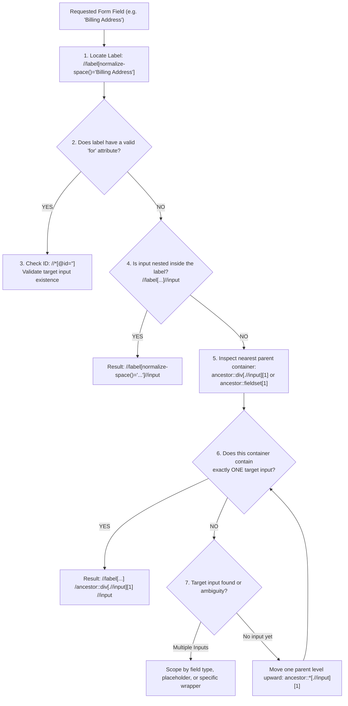

# Skill: Smart Selenium Locator Generator

This skill is responsible for analyzing HTML snippets, live DOM nodes (via the **Selenium MCP**), or element descriptions to engineer **ultra-stable, maintainable, and unique Selenium locators** for Python test automation frameworks.

It also provides an **audit and review capability** to detect fragile locators in existing Page Objects and suggest resilient replacements.

---

## 0. Core Philosophy: Semantic Identity over Spatial Position

> **Golden Rule**: Never locate an element by *where it sits* in the DOM tree (e.g. `/div[3]/div[2]/input` or `div:nth-child(4)`). Always locate an element by *who it is* (its unique ID, name, test attribute) or *what it relates to* (its human label, ARIA descriptor, or nearest semantic boundary).

When the layout changes (e.g. a banner is inserted, columns reorder, or containers wrap), positional locators break instantly. Semantic locators survive UI redesigns.

---

## 1. The 8-Tier Locator Generation Priority

Evaluate the target element against this strict priority hierarchy. Select the highest-ranking tier that yields a **unique (count == 1)** and **stable** match:

| Tier | Strategy | Implementation Example | When to Use & Stability Checks |
| :--- | :--- | :--- | :--- |
| **1** | **`By.ID`** | `find_by(By.ID, "username")` | **First choice**, provided the ID is **static**. Reject IDs with auto-generated numeric suffixes (e.g. `mat-input-0`, `field_149823`, GUIDs, or framework hashes `ember-123`). |
| **2** | **`By.NAME`** | `find_by(By.NAME, "email_address")` | Use when no static ID exists and the `name` attribute is unique within the document or form. |
| **3** | **`Label` (Semantic)** | `find_by(By.XPATH, "//label[normalize-space()='Email']/ancestor::div[.//input][1]//input")` | **Primary reference for form inputs** when direct static ID/Name is missing. Uses progressive container ascent. |
| **4** | **`aria-label`** | `find_by(By.CSS_SELECTOR, "[aria-label='Search products']")` | High priority for icon buttons, search bars, modals, and accessible interactive widgets lacking visible text. |
| **5** | **`aria-labelledby`** | `find_by(By.XPATH, "//*[@id=//*[@id='target']/@aria-labelledby]")` | Resolves the semantic connection to an external header or descriptive label element. |
| **6** | **`data-*` Testing Attributes** | `find_by(By.CSS_SELECTOR, "[data-testid='submit-btn']")` | Ideal in modern React/Vue/Angular apps (`data-testid`, `data-test`, `data-qa`, `data-cy`). Stable across CSS restyling. |
| **7** | **Relative XPath** | `find_by(By.XPATH, "//button[normalize-space()='Confirm' and not(@disabled)]")` | Expressive relationships: text normalization, sibling navigation (`following-sibling::`), or ancestor scoping. |
| **8** | **CSS Selector** | `find_by(By.CSS_SELECTOR, "form.checkout-form button.btn-primary")` | Fast fallback. Restrict to stable semantic class names and tag combinations. Never rely on utility classes alone (e.g. `.flex.pt-4`). |

---

## 2. Form Element Locator Strategy (Label-Driven Traversal)

For form elements (text inputs, textareas, selects, checkboxes, switches, datepickers), **the human-readable Label is the primary anchor of truth** whenever direct static ID or Name attributes are unavailable.

### The 8-Stage Progressive Resolution Algorithm



### XPath Implementation Blueprints by Label Relationship:

1. **Explicit `for` Attribute Linking**:
   ```python
   # HTML: <label for="user_email">Email</label><input id="user_email" />
   input_email = find_by(By.ID, "user_email", label="Email")
   ```

2. **Nested Input Inside Label (Common in Checkboxes/Switches/Radio)**:
   ```python
   # HTML: <label class="checkbox-container">Accept Terms<input type="checkbox" /></label>
   chk_terms = find_by(
       By.XPATH,
       "//label[contains(normalize-space(), 'Accept Terms')]//input[@type='checkbox']",
       label="Accept Terms Checkbox"
   )
   ```

3. **Adjacent / Sibling Layout**:
   ```python
   # HTML: <label>Phone</label><input type="tel" />
   input_phone = find_by(
       By.XPATH,
       "//label[normalize-space()='Phone']/following-sibling::input[1]",
       label="Phone Input"
   )
   ```

4. **Progressive Upward Container Traversal (Material, Bootstrap, Tailwind, Form-Group)**:
   ```python
   # HTML: <div class="form-group"><label>Country</label><div class="control"><select>...</select></div></div>
   ddl_country = find_by(
       By.XPATH,
       "//label[normalize-space()='Country']/ancestor::div[.//select][1]//select",
       label="Country Dropdown"
   )
   ```

5. **Multi-Input Row Disambiguation (e.g. First Name & Last Name in same container)**:
   ```python
   # Scoped by placeholder, type, or position relative to the sub-label
   input_first_name = find_by(
       By.XPATH,
       "//label[normalize-space()='Full Name']/ancestor::div[.//input][1]//input[@placeholder='First Name' or contains(@name, 'first')]",
       label="First Name Input"
   )
   ```

---

## 3. Locator Stability Rules (Strict Blacklist & Whitelist)

### ⛔ Strict Blacklist (Never Generate These)
- **Absolute XPaths**: `/html/body/div[1]/div[2]/div/form/div[3]/input` $\rightarrow$ Extremely brittle.
- **Positional Indices Without Anchors**: `//input[2]` or `(//button)[5]`.
- **CSS Positional Pseudo-classes**: `div:nth-child(3) > input:nth-of-type(1)`.
- **Dynamic Hash Classes**: `.css-19z0x8`, `._2xK8q`, `.styled__Input-sc-1234`.
- **Transient State Classes**: `.is-active`, `.hover`, `.focus`, `.is-loading`, `.touched`, `.ng-dirty`.
- **Auto-generated IDs**: `id="input-1482"`, `id="ember451"`, `id=":r2:"` (React 18 useId), `id="mat-input-3"`.
- **Unbounded Wildcards**: `//*` without restricting attributes or ancestors.

###  Strict Whitelist (Preferred Patterns)
- **Exact or Normalized Text Match**: `[normalize-space()='Login']` or `[contains(normalize-space(), 'Submit')]`.
- **Semantic HTML5 Tags**: `header`, `nav`, `main`, `article`, `section`, `table`, `form`, `dialog`.
- **Accessibility Attributes**: `aria-label`, `role`, `aria-labelledby`, `aria-expanded`.
- **Stable Data Attributes**: `data-testid`, `data-test`, `data-qa`, `data-automation-id`.
- **Specific Input Types**: `input[@type='email']`, `input[@type='password']`, `button[@type='submit']`.

---

## 4. Locator Validation Protocol

When inspecting a live page via the **Selenium MCP** (`get_element_text`, `execute_script`, `get_element_attribute`) or evaluating an HTML snippet:

1. **Uniqueness Audit**:
   Execute locator in JS / browser context:
   ```javascript
   // For CSS:
   document.querySelectorAll("<selector>").length === 1;

   // For XPath:
   document.evaluate("count(<xpath>)", document, null, XPathResult.NUMBER_TYPE, null).numberValue === 1;
   ```
   *If count > 1*, reject immediately. Ascend to a unique parent container or add a semantic discriminator.

2. **Element Type Verification**:
   Verify that the matched tag corresponds to the desired semantic element (e.g. `<input>`, `<button>`, `<select>`, `<textarea>`).

3. **Visibility & Interactivity Check**:
   Confirm the element is not hidden (`type='hidden'`, `display: none`, or `visibility: hidden`) unless testing hidden inputs.

4. **Ambiguity Handling**:
   If the HTML snippet is truncated or does not contain a unique anchor, **never invent an arbitrary index `[1]`**. State the ambiguity clearly and request additional surrounding HTML.

---

## 5. Output Format & Framework Conventions

Provide locator proposals using both the **Method Decorator** and **Class Attribute Descriptor** formats supported by the framework.

### Standard Output Template

````markdown
### 🎯 Element: `<Human-Readable Element Name>`

#### 1. Identification Summary
- **Target Tag:** `<tag>`
- **Semantic Role:** `<Input / Button / Text / Dropdown / Checkbox / Table / Container>`
- **Recommended Prefix:** `<input_ / btn_ / lbl_ / ddl_ / chk_ / tbl_ / mdl_>`
- **Selected Tier:** `Tier <X> (<Strategy Name>)`

#### 2. Generated Framework Code

```python
# Option A: Class Attribute Descriptor (Standard Page Object)
<prefix>_<name> = find_by(
    <By.STRATEGY>,
    "<locator_value>",
    label="<Human Label>",
    anchor=<True/False>
)

# Option B: Method Decorator (@find_by)
@find_by(<By.STRATEGY>, "<locator_value>")
<prefix>_<name> = None
```

#### 3. Engineering Rationale
- **Why this strategy:** Explains why Tier `<X>` was chosen over lower/higher tiers.
- **Resilience Analysis:** Why this selector resists DOM refactoring, localization shifts, and styling changes.
- **Uniqueness Status:** Confirmed unique (`count == 1`).

#### 4. Resilient Alternative (Fallback)
```python
<prefix>_<name>_alt = find_by(<By.ALT_STRATEGY>, "<alt_locator_value>", label="<Human Label> Alternative")
```
````

---

## 6. Locator Review & Audit Capability

When asked to review an existing locator, assess it against the **4 Resilience Pillars**:

1. **Uniqueness:** Does it identify exactly one element, or could it collide with list items/clones?
2. **Stability:** Does it rely on transient classes, dynamic IDs, or strict parent hierarchies?
3. **Maintainability:** Is the locator readable by QA team members without deciphering cryptic regex?
4. **DOM-Resistance:** Will it break if an adjacent element is added or CSS styling changes?

### Review Audit Table Format

| Original Locator | Diagnosis & Vulnerability | Severity | Recommended Resilient Replacement |
| :--- | :--- | :--- | :--- |
| `//div[2]/form/div[3]/input` | Absolute positional index; breaks upon DOM reorder. | 🔴 High | `find_by(By.XPATH, "//label[normalize-space()='Email']/ancestor::div[.//input][1]//input")` |
| `button.css-1r982j` | Auto-generated Emotion/CSS-in-JS hash class. | 🔴 High | `find_by(By.XPATH, "//button[normalize-space()='Checkout']")` |
| `//*[@id='input-14']` | Auto-generated framework sequential ID. | 🟡 Medium | `find_by(By.NAME, "shipping_city")` |
| `//span[text()='Submit']` | Sensitive to whitespace; `text()` breaks with nested tags. | 🟢 Low | `find_by(By.XPATH, "//button[normalize-space()='Submit']")` |

---

## 7. Comprehensive Reference Catalog of Real-World Patterns

### Pattern A: Modern Floating Label (Material / Tailwind)
```html
<div class="relative rounded-md border border-gray-300">
  <input type="text" name="user_zip" class="peer block w-full border-0" placeholder=" " />
  <label class="absolute duration-300 transform -translate-y-4 scale-75 top-2">ZIP Code</label>
</div>
```
**Recommended Locator:**
```python
input_zip_code = find_by(
    By.XPATH,
    "//label[normalize-space()='ZIP Code']/preceding-sibling::input | //label[normalize-space()='ZIP Code']/ancestor::div[.//input][1]//input",
    label="ZIP Code Input"
)
```

### Pattern B: Shadow DOM / Custom Web Component
```html
<user-card-element>
  <button aria-label="Edit Profile Details">
    <svg>...</svg>
  </button>
</user-card-element>
```
**Recommended Locator:**
```python
btn_edit_profile = find_by(
    By.CSS_SELECTOR,
    "user-card-element button[aria-label='Edit Profile Details']",
    label="Edit Profile Details Button"
)
```

### Pattern C: Table Row Action by Dynamic Entity
```html
<tr>
  <td class="customer-name">Acme Corp</td>
  <td>Active</td>
  <td>
    <button class="action-btn" title="Delete Customer">🗑️</button>
  </td>
</tr>
```
**Dynamic Locator Template:**
```python
# Layer 1
btn_delete_customer = find_by(
    By.XPATH,
    "//tr[td[contains(normalize-space(), '{customer_name}')]]//button[@title='Delete Customer' or .//span[text()='Delete']]",
    label="Delete Customer Button for {customer_name}"
)

# Layer 2 Usage:
# self.btn_delete_customer.format(customer_name="Acme Corp").click()
```

### Pattern D: Accessible Modal Dialog
```html
<div role="dialog" aria-labelledby="dialog-title" class="modal-box">
  <h2 id="dialog-title">Delete Account Confirmation</h2>
  <button class="btn-danger">Confirm Deletion</button>
</div>
```
**Recommended Locator:**
```python
mdl_delete_confirm = find_by(
    By.XPATH,
    "//div[@role='dialog'][.//h2[normalize-space()='Delete Account Confirmation']]",
    label="Delete Account Confirmation Modal"
)
btn_confirm_delete = find_by(
    By.XPATH,
    "//div[@role='dialog'][.//h2[normalize-space()='Delete Account Confirmation']]//button[normalize-space()='Confirm Deletion']",
    label="Confirm Deletion Button"
)
```

