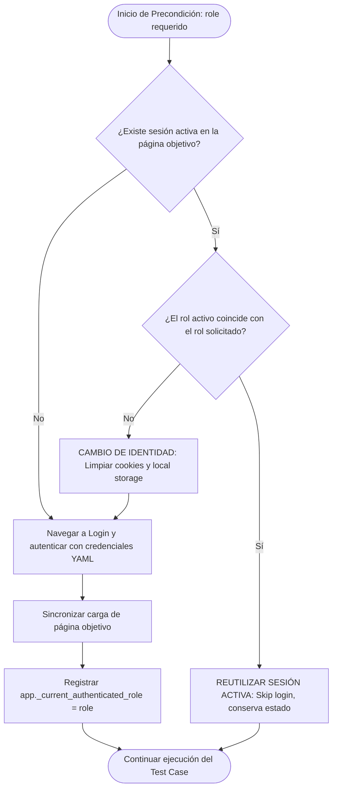

# Arquitectura de Precondiciones y Gestión de Sesión Inteligente (Session-Aware RBAC)

Esta guía explica en profundidad el funcionamiento del patrón **Session-Aware Preconditions** utilizado en el framework para pruebas basadas en roles (RBAC) y gestión del ciclo de vida del navegador.

---

## 1. El Problema Arquitectónico

En suites de automatización enterprise surgen dos problemas comunes:

1. **Repetición Innecesaria de Login**: Escribir `login_page.open().login(...)` en decenas de tests de catálogo, carrito o checkout acopla los tests al formulario de login y ensucia los reportes.
2. **Conflicto de Sesiones en Navegadores Compartidos**: Si una clase de prueba usa una sesión compartida (`persistent_session = True`) para ganar velocidad, y `Test_A` requiere `standard_user` mientras que `Test_B` requiere `problem_user`, la sesión del usuario anterior contamina la ejecución del siguiente.

---

## 2. La Solución: Fixtures "Session-Aware"

El framework implementa precondiciones inteligentes ubicadas en `applications/web/<app>/fixtures/preconditions.py`. Cada fixture está asociado a un rol definido en el YAML del ambiente (`config/environments/<env>.yaml`).

### Flujo de Decisión del Fixture (`authenticate_as_role`)



---

## 3. Modos de Ejecución del Navegador

| Característica | Modo Aislamiento (`persistent_session = False`) | Modo Persistente (`persistent_session = True`) |
|---|---|---|
| **Comportamiento** | Abre y cierra un navegador nuevo por cada test (`driver.quit()`). | Mantiene la misma ventana de navegador abierta para toda la clase. |
| **Uso Ideal** | Pruebas atómicas independientes, validación de login/errores. | Flujos secuenciales de negocio, Wizards multietapa, testing rápido. |
| **Riesgo de contaminación** | Cero (cada test tiene cookies limpias). | Cero (el fixture gestiona el *Identity Switch* si cambia el rol). |
| **Velocidad** | Moderada (overhead de abrir y cerrar Chrome). | Máxima (sin reinicios de navegador). |

---

## 4. Catálogo de Fixtures Estándar

En la aplicación Demo (`SauceDemo`), los fixtures disponibles en `preconditions.py` son:

- `as_standard_user`: Autentica al usuario estándar de compras.
- `as_problem_user`: Autentica al usuario con defectos de UI e imágenes rotas.
- `as_performance_glitch_user`: Autentica al usuario con latencia controlada.
- `as_error_user`: Autentica al usuario con botones rotos.
- `as_visual_user`: Autentica al usuario con inconsistencias visuales.
- `logged_in_session`: Fixture genérica que resuelve el `default_role` del ambiente.

Todos los fixtures se registran en `applications/web/<app>/tests/conftest.py` para estar disponibles automáticamente en todas las suites de prueba.

---

## 5. Ejemplos de Implementación

### Ejemplo 1: Test Funcional con Precondición (Modo Aislamiento)

```python
import pytest
import allure
from core.ui.common.base_test import BaseTest
from core.utils.decorators import test_case
from applications.web.demo.utils.decorators import demo

@demo
class TestCartOperations(BaseTest):

    @test_case(id="CT-CART-001")
    @pytest.mark.usefixtures("as_standard_user")
    def test_add_backpack_to_cart(self):
        # La precondición ya abrió el navegador y autenticó a standard_user.
        # El test inicia directamente en Inventory:
        with allure.step("1. Agregar mochila al carrito"):
            self.app.inventory_page.add_backpack_to_cart()

        with allure.step("2. Validar que el badge del carrito muestra 1 item"):
            assert self.app.inventory_page.get_cart_count() == 1
```

### Ejemplo 2: Flujo Secuencial Multirrol (Modo Persistente)

```python
import pytest
import allure
from core.ui.common.base_test import BaseTest
from core.utils.decorators import test_case
from applications.web.demo.utils.decorators import demo

@demo
class TestSequentialRoleComparison(BaseTest):
    persistent_session = True  # Mismo navegador para toda la clase

    @test_case(id="CT-COMP-001")
    @pytest.mark.usefixtures("as_standard_user")
    def test_standard_user_sees_normal_images(self):
        # Paso 1: Autentica como standard_user
        assert self.app.inventory_page.get_broken_images_count() == 0

    @test_case(id="CT-COMP-002")
    @pytest.mark.usefixtures("as_standard_user")
    def test_standard_user_retains_session(self):
        # Paso 2: REUTILIZA la sesión del test anterior sin re-loguear
        assert self.app.inventory_page.is_title_visible()

    @test_case(id="CT-COMP-003")
    @pytest.mark.usefixtures("as_problem_user")
    def test_problem_user_switch(self):
        # Paso 3: IDENTITY SWITCH automático: limpia cookies y entra como problem_user
        assert self.app.inventory_page.get_broken_images_count() > 0
```

